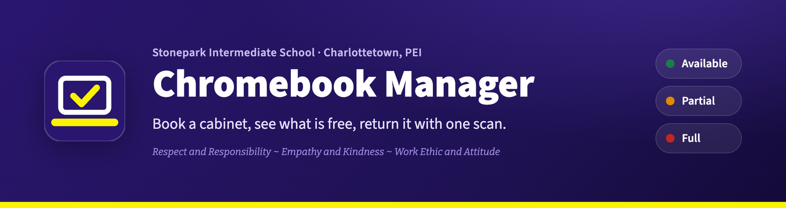
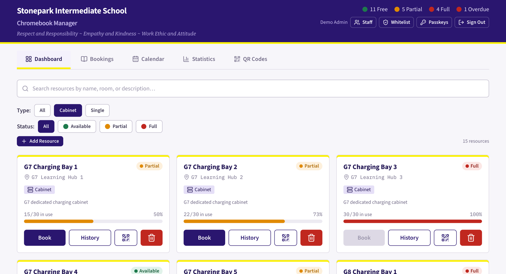
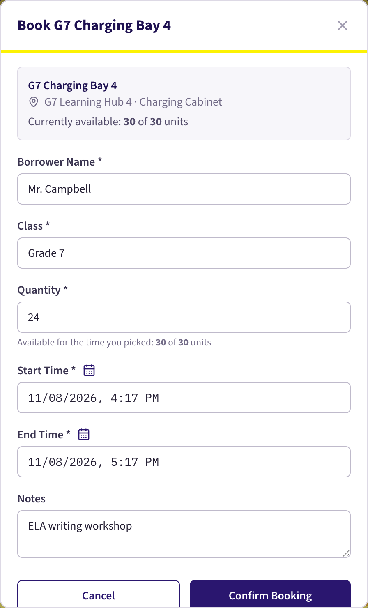
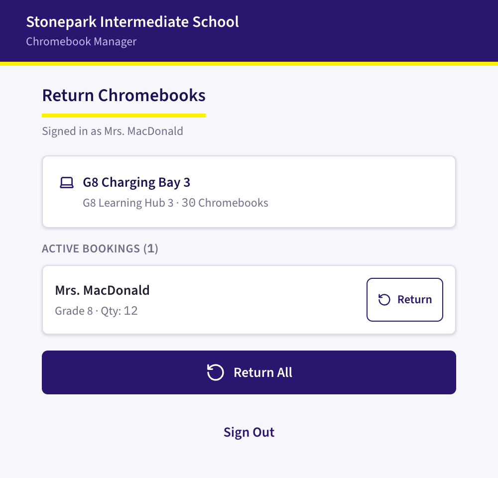
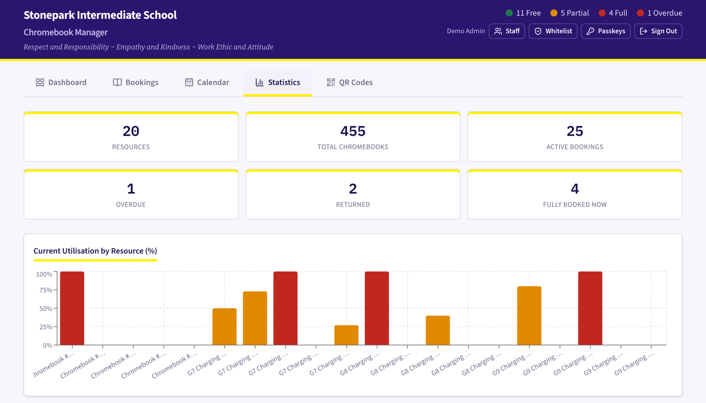
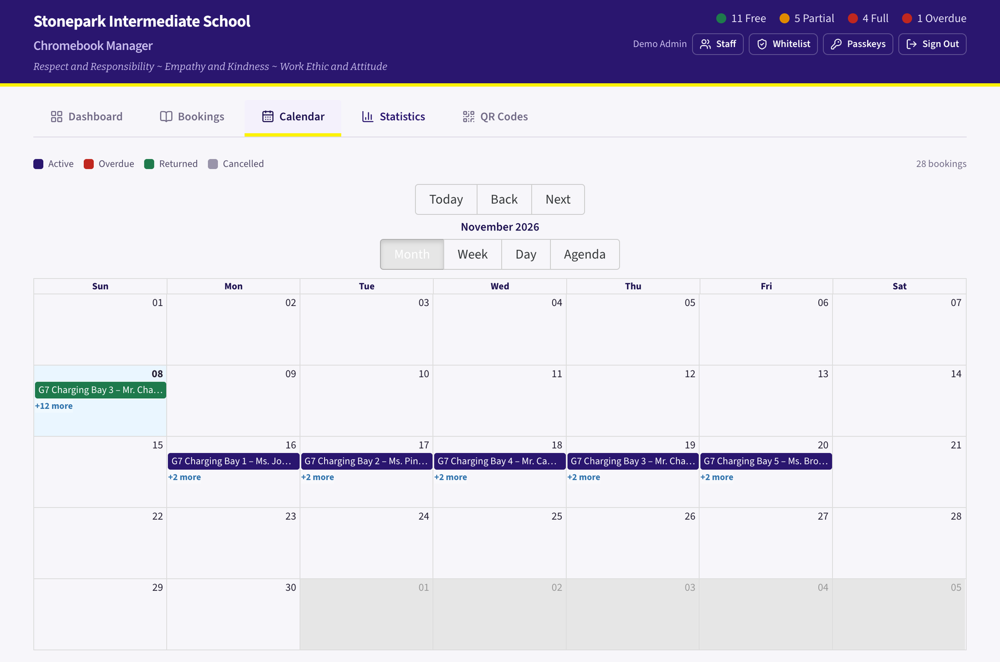
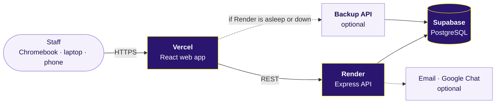

<p align="center">
  
</p>

<p align="center">
  <a href="https://stonepark-chromebook-manager.vercel.app"><strong>Open the app</strong></a>
  &nbsp;&middot;&nbsp;
  <a href="EXPLAIN.md"><strong>Staff guide</strong></a>
  &nbsp;&middot;&nbsp;
  <a href="#for-maintainers-and-developers"><strong>For developers</strong></a>
</p>

<p align="center">
  
  
  
  
  
  
</p>

<br>

**Stonepark Chromebook Manager** is the booking system for the shared Chromebook charging cabinets at Stonepark Intermediate School. Teachers reserve a cabinet for a class, everyone sees the same live picture of what is free, and devices are returned by scanning the QR code on the cabinet.

<p align="center">
  
  <br>
  <sub>The dashboard. Each cabinet shows how many Chromebooks are in use right now. All screenshots use demo data.</sub>
</p>

## At a Glance

| | |
|---|---|
| **Who uses it** | Teaching staff and administrators at Stonepark Intermediate School |
| **Works on** | School Chromebooks, laptops, phones and tablets. Nothing to install. |
| **Sign-in** | Approved staff only. Email and password, or a passkey (fingerprint, face or screen lock). |
| **Students** | Do not sign in. The system holds staff accounts and booking records only. |
| **Running cost** | $0 today, on the free tiers of Vercel, Render and Supabase |
| **Licence** | Apache 2.0 |

## How It Works

<table>
  <tr>
    <td width="55%" valign="top">
      <h3>1. Book</h3>
      <p>Find a cabinet on the dashboard and press <b>Book</b>. Your name is already filled in.</p>
      <p>The form shows how many Chromebooks are free <i>for the time you choose</i>, not just right now. A booking that needs more devices than are free in that slot is refused, so no two classes are promised the same Chromebooks.</p>
      <p align="center"></p>
    </td>
    <td width="45%" valign="top">
      <h3>2. Return</h3>
      <p>Scan the QR code on the cabinet with a phone camera and tap <b>Return</b>.</p>
      <p>The phone remembers the teacher for 30 days, so returning takes two taps. Until a booking is returned, the cabinet shows as busy for everyone else.</p>
      <p align="center"></p>
    </td>
  </tr>
</table>

## What Staff Get

<table>
  <tr>
    <td width="33%" valign="top">
      <b>Live availability</b><br>
      Green, amber and red show which cabinets are free, partly in use or full. The page refreshes itself every 30 seconds.
    </td>
    <td width="33%" valign="top">
      <b>Overdue at a glance</b><br>
      Bookings that run past their end time turn red and are counted in the header, so nobody has to go looking.
    </td>
    <td width="33%" valign="top">
      <b>Calendar</b><br>
      Month, week, day and agenda views of every booking, colour-coded by status.
    </td>
  </tr>
  <tr>
    <td valign="top">
      <b>Usage statistics</b><br>
      Utilisation for every cabinet and booking counts per staff member, to show where devices are needed most.
    </td>
    <td valign="top">
      <b>Printable QR codes</b><br>
      One code per cabinet. Codes use the cabinet's internal ID, so renaming a cabinet does not break them.
    </td>
    <td valign="top">
      <b>Optional notifications</b><br>
      Email or Google Chat messages when a booking is made or returned.
    </td>
  </tr>
</table>

<table>
  <tr>
    <td width="50%"></td>
    <td width="50%"></td>
  </tr>
  <tr>
    <td align="center"><sub>Statistics</sub></td>
    <td align="center"><sub>Calendar</sub></td>
  </tr>
</table>

## Built for a School

- **Only approved staff get in.** Every account must be on the staff list. A new teacher presses *Apply for Access*. Admins see the request, with a count on the Whitelist button, and approve or reject it.
- **No single account can take over.** Making someone an admin, or removing an admin, needs a yes from every other admin.
- **No passwords to remember, if staff prefer.** A passkey signs in with a fingerprint, face or screen lock. Passwords always keep working, and a forgotten one can be reset with three security questions.
- **Changes are recorded.** Edits to a cabinet's name, location or description are logged with who made them and when.
- **Protected against guessing.** Sign-in attempts are rate-limited to 20 per 15 minutes, and passwords are stored only as bcrypt hashes.
- **Low cost, low upkeep.** It runs on free hosting tiers today. If use ever outgrew them, the estimate is about $20–45 a month.

Day-to-day running (adding staff, resetting passwords, fixing a booking) is covered in the handover pack provided to the school. Staff only need the one-page [Staff guide](EXPLAIN.md).

---

## For Maintainers and Developers

### Architecture



The API currently runs on Render. [`api/index.js`](api/index.js) already wraps the same Express app as a Vercel serverless function, and [`vercel.json`](vercel.json) routes `/api/*` to it, so the API can later move onto Vercel and Render can be retired.

### Tech Stack

| Layer | Technology |
|---|---|
| Frontend | React 19, TypeScript, Tailwind CSS 3, Recharts, react-big-calendar, qrcode.react, Axios |
| Backend | Node.js, Express 5 |
| Database | PostgreSQL on Supabase in production; SQLite (`better-sqlite3`) for local development |
| Auth | JWT sessions, bcrypt password hashes, passkeys via SimpleWebAuthn |
| Notifications | Nodemailer (SMTP), Google Chat incoming webhook |
| Offline / install | Custom service worker and web app manifest (PWA) |
| Hosting | Vercel (frontend), Render (API), Supabase (database) |

> [!NOTE]
> There is deliberately no "Sign in with Google". A school-managed browser extension blocks staff Google accounts, so the OAuth code was removed. Check with school IT before adding it back.

### Run It Locally

Requires Node.js 20.6 or newer.

```bash
git clone https://github.com/Charlie0113-T/Stonepark-Chromebooks-Borrowing-System.git
cd Stonepark-Chromebooks-Borrowing-System
npm run install:all
```

Create `backend/.env`:

```dotenv
PORT=4000
NODE_ENV=development
JWT_SECRET=local-dev-secret-change-me
CORS_ORIGIN=http://localhost:3000
ADMIN_USERS=admin@example.com:ChangeMe123
WHITELIST_SEED=admin@example.com
```

Create `frontend/.env.local`:

```dotenv
REACT_APP_API_URL=http://localhost:4000
```

Start the API and the app in two terminals:

```bash
cd backend && node --env-file=.env index.js   # API on http://localhost:4000
cd frontend && npm start                       # app on http://localhost:3000
```

Sign in as `admin@example.com` / `ChangeMe123`. With no `DATABASE_URL`, the API creates `backend/data/chromebook.db` and fills it with demo cabinets. Passkeys work on `localhost` without extra settings.

> [!TIP]
> The API does not read `.env` by itself. `--env-file` loads it. An admin must appear in **both** `ADMIN_USERS` and `WHITELIST_SEED`, or sign-in is refused with "not on the whitelist".

Run the frontend tests with `cd frontend && CI=true npm test`. The backend has no automated tests yet.

### Configuration

<details>
<summary><b>Backend environment variables</b></summary>

| Variable | Required | Purpose |
|---|---|---|
| `DATABASE_URL` | Production | PostgreSQL connection string (Supabase). Without it, SQLite is used. |
| `PGSSLMODE` | Production | `require` |
| `NODE_ENV` | Production | `production` |
| `JWT_SECRET` | Yes | Long random string, e.g. `openssl rand -base64 32` |
| `CORS_ORIGIN` | Production | Frontend URL(s). If unset, every origin is accepted, so always set it. |
| `ADMIN_USERS` | Yes | `email:password` pairs, comma-separated |
| `STAFF_USERS` | Optional | `Name:email:password` entries, comma-separated |
| `WHITELIST_SEED` | Optional | Emails added to the staff list on first boot. Include every admin. |
| `WEBAUTHN_RP_ID` | For passkeys | Frontend domain without scheme, e.g. `stonepark-chromebook-manager.vercel.app` |
| `WEBAUTHN_ORIGIN` | For passkeys | Full frontend origin, e.g. `https://stonepark-chromebook-manager.vercel.app` |
| `WEBAUTHN_RP_NAME` | Optional | Name shown in the passkey prompt |
| `SMTP_HOST`, `SMTP_PORT`, `SMTP_SECURE`, `SMTP_USER`, `SMTP_PASS` | Optional | Outgoing mail. Without them, email is skipped silently. |
| `NOTIFY_FROM`, `NOTIFY_TO` | Optional | Sender and recipient for booking emails |
| `GOOGLE_CHAT_WEBHOOK_URL` | Optional | Google Chat space webhook |
| `AUTH_BYPASS` | Never in production | `true` skips sign-in entirely. Local experiments only. |

</details>

<details>
<summary><b>Frontend environment variables</b></summary>

| Variable | Required | Purpose |
|---|---|---|
| `REACT_APP_API_URL` | Yes, while the API is on Render | Base URL of the API |
| `REACT_APP_API_FALLBACK_URL` | Optional | HTTPS URL of a backup API (see below) |

</details>

> [!WARNING]
> Treat `WEBAUTHN_RP_ID` as permanent. Passkeys are bound to the domain they were created on, so moving to a new domain (including a custom school domain) makes every staff passkey stop working. Passwords keep working, so nobody is locked out, but each teacher has to add a new passkey.

### Deployment

- **Frontend (Vercel).** [`vercel.json`](vercel.json) installs, builds with `npm run build --prefix frontend` and serves `frontend/build`.
- **API (Render).** [`render.yaml`](render.yaml) defines the service. It starts with `npm start --prefix backend` and is health-checked at `/health`. Set the backend variables above in the Render dashboard.
- **Database (Supabase).** Tables are created automatically when the API starts.

#### Backup API (optional failover)

- A second copy of the backend can run anywhere with the **same** `DATABASE_URL` and `JWT_SECRET` as Render, so both hosts read and write the same data and accept each other's sessions.
- Set `REACT_APP_API_FALLBACK_URL` on the frontend to the backup's HTTPS URL. When Render is asleep (reads wait at most 12 s), blocked at its edge, or down, the app retries reads and sign-ins on the backup and keeps using it for 10 minutes before trying Render again.
- Other writes (bookings, returns, admin changes) are never replayed automatically, since the first attempt may already have been saved. The user's next attempt goes to the other host.
- The backend's own `429` responses (sign-in rate limits) never trigger a switch.

### API Reference

All endpoints are under `/api`. **Staff** means a signed-in account on the staff list; **Admin** means an admin account.

<details>
<summary><b>Accounts and sign-in</b> — <code>/api/auth</code></summary>

| Method | Endpoint | Access | Description |
|---|---|---|---|
| `POST` | `/auth/signup` | Public | Create an account (email must be on the staff list) |
| `POST` | `/auth/login` | Public | Sign in and receive a JWT |
| `POST` | `/auth/logout` | Public | Sign out |
| `POST` | `/auth/forgot-password` | Public | Start a reset with the three security answers |
| `POST` | `/auth/reset-password` | Public | Set a new password |
| `POST` | `/auth/whitelist/apply` | Public | Apply for access |
| `GET` | `/auth/me` | Staff | Current user |
| `POST` | `/auth/setup-security-questions` | Staff | Save security answers |
| `POST` | `/auth/passkeys/register/options`, `/register/verify` | Staff | Add a passkey |
| `POST` | `/auth/passkeys/login/options`, `/login/verify` | Public | Sign in with a passkey |
| `GET` | `/auth/passkeys` | Staff | List your passkeys |
| `DELETE` | `/auth/passkeys/:credentialId` | Staff | Remove a passkey |

</details>

<details>
<summary><b>Staff administration</b> — <code>/api/auth</code></summary>

| Method | Endpoint | Access | Description |
|---|---|---|---|
| `GET` `POST` `DELETE` | `/auth/whitelist` | Admin | View, add or remove approved emails. Admins can only be removed by vote. |
| `GET` | `/auth/whitelist/applications` | Admin | Pending access requests |
| `POST` | `/auth/whitelist/applications/:email/approve`, `/reject` | Admin | Approve or reject a request |
| `GET` `POST` | `/auth/whitelist/promotions` | Admin | List or propose admin promotions |
| `POST` | `/auth/whitelist/promotions/:email/vote` | Admin | Vote on a promotion |
| `DELETE` | `/auth/whitelist/promotions/:email` | Admin | Withdraw a promotion |
| `GET` `POST` | `/auth/whitelist/removals` | Admin | List or propose removing an admin |
| `POST` | `/auth/whitelist/removals/:email/vote` | Admin | Vote on a removal |
| `GET` `POST` | `/auth/users` | Admin | List or create staff accounts |
| `PATCH` | `/auth/users/:email/password` | Admin | Reset a password |
| `DELETE` | `/auth/users/:email` | Admin | Delete a staff account (not an admin) |

</details>

<details>
<summary><b>Cabinets, bookings and statistics</b></summary>

| Method | Endpoint | Access | Description |
|---|---|---|---|
| `GET` | `/resources` | Staff | All cabinets and devices with live availability (`?schoolId=`) |
| `GET` | `/resources/:id` | Staff | One resource |
| `GET` | `/resources/:id/history` | Staff | Change log |
| `POST` | `/resources` | Staff | Add a resource |
| `PUT` | `/resources/:id` | Staff | Edit a resource |
| `DELETE` | `/resources/:id` | Admin | Delete (refused while it has active bookings) |
| `POST` | `/resources/:id/return-all` | Staff | Mark every active booking on this resource as returned (used by the QR page) |
| `GET` | `/bookings` | Staff | List bookings (`?resourceId=`, `?status=`, `?search=`, `?schoolId=`) |
| `GET` | `/bookings/:id` | Staff | One booking |
| `POST` | `/bookings` | Staff | Create a booking (refused if not enough devices are free) |
| `PATCH` | `/bookings/:id/return` | Staff | Mark as returned |
| `PATCH` | `/bookings/:id/cancel` | Staff | Cancel |
| `GET` | `/schools`, `/schools/:id` | Staff | Schools and campuses |
| `POST` | `/schools` | Admin | Add a school |
| `GET` | `/stats` | Staff | Totals and per-resource utilisation (`?schoolId=`) |
| `GET` | `/health` | Public | Health check (also at `/health`) |

</details>

<details>
<summary><b>Project structure</b></summary>

```text
├── api/index.js                    # Vercel serverless entry (wraps the Express app)
├── backend/
│   ├── index.js                    # Express server
│   ├── scripts/                    # Whitelist check and sync helpers
│   └── src/
│       ├── db/database.js          # PostgreSQL or SQLite, schema, demo seed data
│       ├── middleware/auth.js      # JWT, staff-list and admin checks
│       ├── models/booking.js       # Availability and overbooking rules
│       ├── routes/                 # auth, passkeys, resources, bookings, schools, stats
│       └── services/notifications.js  # Email and Google Chat
├── frontend/
│   ├── public/                     # Icons, PWA manifest, service worker
│   ├── scripts/build-icons.swift   # Regenerates every icon from favicon.svg
│   └── src/
│       ├── App.tsx                 # Layout, header and tabs
│       ├── api/index.ts            # API client with backup-server failover
│       ├── components/             # Cards, booking form, calendar, statistics, QR, staff admin, passkeys
│       ├── styles/stonepark-tokens.css  # School colours and fonts
│       └── utils/                  # Passkey and browser-credential helpers, with tests
├── docs/images/                    # README images (demo data)
├── EXPLAIN.md                      # One-page guide for staff
├── render.yaml                     # Render service definition
└── vercel.json                     # Vercel build and routing
```

</details>

### Known Limitations

- **Cold starts.** Render's free tier sleeps after 15 minutes without use, so the first request can take 30–60 seconds. The app says it is waking up and retries by itself. Moving the API onto Vercel, or adding a backup API, removes most of the wait.
- **One school per deployment.** Resources carry a school ID and the dashboard can filter by campus, but this is a filter, not separation: the staff list, admins and branding are shared. Serving several schools would need proper tenant isolation.
- **Sessions are not revoked on the server.** Signing out clears the browser's token. To cut off someone's access, remove them from the staff list; that takes effect on their next request.
- **Backups.** There is no automated off-site backup. Export the database regularly.

## Licence

Apache License 2.0. See [LICENSE](LICENSE) and [NOTICE](NOTICE).

Copyright 2026 Charles Tao. Built for Stonepark Intermediate School, Charlottetown, Prince Edward Island.
